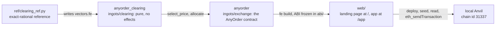

<!-- readme-schema: R2-contract-protocol v1 + event-overlay -->
<div align="center">

# AnyOrder

**A uniform-price batch-auction exchange in Fe whose fills are independent of transaction order, so a sandwich has no ordering to exploit.**


[Demo video](https://youtu.be/8QCVwiO_9c8) · [Live page](https://anyorder.suitz.xyz/) · [The contest](https://fe-lang.org/contest/) · [Verify it yourself](#verify-it-yourself) · [Run locally](#run-locally)

</div>

On a continuous exchange the order of transactions sets your price, and whoever controls that order can sandwich you. AnyOrder takes the order away. Orders collect for a fixed-length batch; then one pure function of the book picks a single price for everyone in it. Going first is worth nothing.

> **Stage: hackathon build, local chain only.** It runs on a local Anvil chain (chain id 31337, Osaka rules) and nothing's deployed to any testnet or mainnet. The order book the app shows is seeded by the setup script, not by real traders. It's an unaudited prototype, built on Fe 26.6.0, a compiler that isn't production-ready yet. Nothing below is claimed past what the tests and `fe test` show.

**Contents**

- [Demo](#demo) · [Explore without a wallet](#explore-without-a-wallet)
- [What it does](#what-it-does)
- [Quickstart](#quickstart) · [Verify it yourself](#verify-it-yourself) · [Run locally](#run-locally)
- [Built at Fe Builders Challenge 2026](#built-at-fe-builders-challenge-2026) · [Contract addresses](#contract-addresses)
- [How it works](#how-it-works) · [The mechanism, step by step](#the-mechanism-step-by-step)
- [Security notes](#security-notes) · [Trust boundaries](#trust-boundaries) · [Gas](#gas)
- [Build & test](#build--test) · [Evidence](#evidence) · [How this could be misleading](#how-this-could-be-misleading)
- [Deploy](#deploy)
- [The problem](#the-problem) · [Why this exists](#why-this-exists)
- [Approach](#approach) · [Fe highlight](#fe-highlight)
- [Architecture](#architecture) · [Repository map](#repository-map)
- [Limitations](#limitations) · [What is real and what is not](#what-is-real-and-what-is-not)
- [Declaration](#declaration) · [Attribution and further reading](#attribution-and-further-reading)
- [Team](#team) · [Roadmap](#roadmap) · [License](#license)

## Demo

[](https://youtu.be/8QCVwiO_9c8)

**[Watch the demo video](https://youtu.be/8QCVwiO_9c8).** The landing page, the evidence on the real compiler, the same sandwich run in the app against the real contracts, and a full batch from order to claim.

The money shot is one command. It runs the real compiler against the real contracts:

```sh
fe test --filter sandwich
```

```
PASS  clearing vector_sandwich_demo_attacker_free
PASS  clearing vector_sandwich_demo_attacked
PASS  clearing sandwich_invariance_property
PASS  exchange sandwich_cpmm_attacker_profits
PASS  exchange sandwich_one_sided_moves_price
PASS  exchange sandwich_batch_attacker_nets_dust

test result: ok. 6 passed; 0 failed
```

And the claim that order doesn't matter, on its own:

```sh
fe test --filter permutation
```

```
PASS  clearing permutation_full_shuffle_keeps_price_and_owner_totals
PASS  exchange permutation_contract_interleavings_seed_7
PASS  exchange permutation_contract_interleavings_seed_8

test result: ok. 3 passed; 0 failed
```

What the numbers say. Pool: 400 TKN / 4.4 ETH, no fee. Batch background: sells of 10 TKN at 0.010, 0.011, 0.012 and 0.013 ETH and a buy of 5 TKN at 0.009. The victim buys 15 TKN with limit 0.012; the attacker's legs are at 0.026 and 0.001. Computed by `ref/clearing_ref.py` and asserted literally by the tests above:

| Scenario | Result |
|---|---|
| Pool, victim alone (0.165 ETH in) | 14.457831325301204819 TKN |
| Pool, sandwiched: front-run 0.11 ETH | attacker gets 9.756097560975609756 TKN |
| Pool, sandwiched: victim | 13.773314203730272596 TKN |
| Pool, sandwiched: back-run | 0.118090638930163447 ETH back, **profit 0.008090638930163447 ETH** |
| Batch, alone and sandwiched | price 0.011 both; victim 15 TKN for exactly 0.165 ETH both |
| Batch, attacker (condition C) | pays 0.107317073170731708, receives ...707: **-1 wei, 0 tokens** |
| One-sided buy of 10 TKN at 0.026 | price 0.011 becomes **0.012**; victim pays 0.18; attacker pays 0.12 at that price and holds 10 TKN |
| In-range wash pair (property test) | book buy 5@7, sell 5@2 clears at 7; with buy 1@6 + sell 1@5 it clears at **6**; the pair nets 0 tokens, at most 0 wei |

The last two rows are where the claim stops, not the headline; see [How this could be misleading](#how-this-could-be-misleading) and [Limitations](#limitations).

Run it yourself in the browser against a local chain with one command (the dApp opens at `/`; the app is at `/app`):

```sh
pnpm -C web install
pnpm -C web local
```

The landing page at `/` is built from a recorded run: "Recorded on a local Anvil chain, 2026-11-18, commit dedf5c5" (`web/public/recorded/sandwich.json`, fe 26.6.0 (5b3f96a), chain id 31337). In the recording the pool sandwich nets the attacker 8090638930163447 wei and the victim 13773314203730272596 tokens instead of 14457831325301204819; the batch sandwich leaves the victim's fill and the price unchanged and the attacker at 0 tokens and -1 wei. `/app` reads the real contract live, and its "Run on your local chain" button repeats the scenario inside Anvil snapshots that are rolled back.

Demo video: https://youtu.be/8QCVwiO_9c8

Live page: https://anyorder.suitz.xyz/ (the landing page; the app needs a local chain, see Quickstart)

### Explore without a wallet

Nothing here asks for a wallet or an account. The hosted site can't reach a chain, so its live panels say how to run the app locally instead of pretending.

| Where | What you see | Needs a wallet |
|---|---|---|
| [`/`](https://anyorder.suitz.xyz/) | The landing page, built from the recorded run and labelled "Recorded on a local Anvil chain" | No |
| [`/app/`](https://anyorder.suitz.xyz/app/) | The hosted app: its static and recorded panels, and in place of each live panel a notice that it needs a local Anvil chain, with the two commands | No |
| [Demo video](https://youtu.be/8QCVwiO_9c8) | The app running against the real contracts on a local chain | No |
| `fe test` | The whole evidence suite on the real compiler: 57 tests | No |
| `pnpm -C web local` | The full app on your own local chain; the built-in traders are Anvil dev accounts with test funds | No |

## What it does

On a constant-product pool or any continuous exchange, a sandwich attacker buys just before your trade and sells just after it, because the order of transactions decides your price. AnyOrder collects orders for a fixed-length batch, then clears all of them at one uniform price computed by a pure function of the book. Arrival order isn't an input, so front-running inside a batch has nothing to gain: every trader of the batch gets the same price, and the fills don't change when the same orders arrive in another order. The clearing rule maximises traded volume, then minimises the imbalance, then breaks the remaining tie by price. Funds are locked when an order is placed and credited by `claim`, so clearing never moves funds. The batch removes ordering, not market power; [Limitations](#limitations) says exactly where the claim stops.

## Quickstart

```sh
fe --version                        # fe 26.6.0 (5b3f96a)
fe test --filter sandwich           # test result: ok. 6 passed; 0 failed
fe test --filter permutation        # test result: ok. 3 passed; 0 failed
pnpm -C web install
pnpm -C web local                   # local Anvil + fe build + deploy + seed + Vite
```

`pnpm -C web local` starts Anvil on port 8545, builds with `fe build`, deploys, funds the built-in traders, seeds one cleared batch and one open batch, writes `web/public/deployment.json` and starts the dev server. Open `/` for the landing page and `/app` for the exchange.

### Verify it yourself

From a clean clone, in the order a judge would run them. No wallet, key or account is needed.

```sh
git clone https://github.com/Dotman-Bei/anyorder && cd anyorder
fe --version                                 # fe 26.6.0 (5b3f96a)
fe test --filter sandwich                    # the headline: 6 passed
fe test --filter permutation                 # order doesn't change price or fills: 3 passed
fe test                                      # the whole suite: 57 passed
python ref/clearing_ref.py --check           # the generated vectors are up to date
python ref/clearing_ref.py --selftest        # 20,000 random books: rule = oracle, lemmas, condition C
bash scripts/check-abi.sh                    # the deployed contracts' ABIs match abi/
bash scripts/mutant-reentrancy.sh            # the reentrancy test fails once the lock is deleted
pnpm -C web install
pnpm -C web test                             # the frontend's unit tests: 41 passed
pnpm -C web local                            # the app on a local chain, at / and /app
```

### Run locally

Tools to install: fe 26.6.0 (on Windows, the release asset; elsewhere `feup`), Foundry (for `anvil` and `cast`), Node 22 with pnpm 10, and Python 3.12. Then `pnpm -C web install` and `pnpm -C web local`. Ctrl+C stops Vite and Anvil together. [Deploy](#deploy) lists everything the command does, and [Contract addresses](#contract-addresses) the addresses it deploys to.

## Built at Fe Builders Challenge 2026

Starting point: "Rethink a protocol", with the "Make the math work" and "Build for the next builder" angles. Rethink a protocol: replace the continuous exchange's order-dependent pricing with a uniform-price batch. Make the math work: an exact clearing rule with a stated tie-break, rationing and rounding, checked against an exact-rational Python reference. Build for the next builder: the clearing rule is a separate ingot with no effects, reusable by another contract.

Team: see [Team](#team). Built from 2026-11-17, starting from the contest starter (`fe-lang/builders-challenge-starter`).

Repository: https://github.com/Dotman-Bei/anyorder

## Contract addresses

| network | address | explorer |
|---|---|---|
| Anvil (local, chain id 31337): TestToken | `0x5FbDB2315678afecb367f032d93F642f64180aa3` | none |
| Anvil (local, chain id 31337): AnyOrder | `0xe7f1725E7734CE288F8367e1Bb143E90bb3F0512` | none |
| Anvil (local, chain id 31337): ConstantProductPool | `0x9fE46736679d2D9a65F0992F2272dE9f3c7fa6e0` | none |

No public network is used. These are the deterministic addresses of Anvil dev account 0's first three deployments on a fresh chain, in the order the deploy script deploys them; re-derive them with `cast compute-address 0xf39Fd6e51aad88F6F4ce6aB8827279cffFb92266 --nonce 0` (then `1`, `2`). `pnpm -C web local` writes the same addresses to `web/public/deployment.json`.

## How it works

### The mechanism, step by step

1. **Place.** A trader calls `placeBuy(limit, quantity)` or `placeSell(limit, quantity)` and the order joins the current batch. A buy locks `cost_ceil(q, limit)` of the trader's free ETH; a sell locks `q` tokens. A batch holds at most `maxOrders` (100).
2. **Close.** Batch k covers `[genesis + k*L, genesis + (k+1)*L)`, with `L` = `batchSeconds` (120 in `deploy/params.json`). Once that window has passed, the batch takes no more orders.
3. **Clear.** Anyone calls `clear(batch)`, once. The contract runs the clearing rule over the book, rations the long side and writes the cleared price and each order's fill. No funds move.
4. **Claim.** Anyone calls `claim(batch, index)` for each order. It credits the order's owner with what the fill bought or sold and unlocks the rest. Owners take free balances out with `withdraw`.

### The clearing rule

`select_price` takes the distinct limit prices as candidates. D(p) is the total buy quantity with limit at or above p; S(p) is the total sell quantity with limit at or below p.

1. Maximise V(p) = min(D, S).
2. Among those, minimise |D - S|.
3. Among those, take the highest price with D >= S; if none, the lowest.

With no price where V > 0 there's no trade and everything is refunded. It's O(N log N): sort, then one ascending sweep. The earlier rule "else lowest" was rejected because a tie mixing excess demand and excess supply made rationing infeasible; the vector `vector_mixed_sign_tie` pins that case.

### Rationing the long side

`allocate` rations only the long side's orders at exactly the clearing price. Strictly better orders, and every order of the short side that can trade, fill in full. Marginal orders share `share = marginal - |D - S|` pro rata by quantity, rounded down. The leftover units go one each to the largest fractional remainder, then larger quantity, then lower owner (address word), then the owner's earlier own order (`owner_seq`).

**Identity wording, kept exactly.** Clearing has no `Ctx` or caller effect; the only identity it reads is each order's recorded owner, used only for the final tie-breaks (owner address, then the owner's own order sequence), which decide at most 1 base unit per order.

**Units.** Quantities are base units of the 18-decimal TestToken; prices are wei per whole token; quote amounts are wei. A trade of `q` at `p` costs `q*p/10^18`. Buyers pay `cost_ceil` (rounded up); sellers receive `proceeds_floor` (rounded down). Quantities are capped at `MAX_QUANTITY = 10^30` base units.

**Rounding and settlement.** Rounding favours the contract, and solvency is a test (below), not an assumption. `clear` writes the cleared price and each order's fill; `claim` credits internal balances; only `withdraw` pays out, and it's the only function that calls out of the contract.

**The clock is an effect.** `Clock { now: Timestamp }` is an effect. The production `AnyOrder` builds it from `ctx.timestamp()`. `AnyOrderTestClock` is a twin that builds it from a stored test time moved forward only by its `setNow`; it exists only for `fe test` and is never deployed (the deploy script uses the allowlist `AnyOrder, TestToken, ConstantProductPool`). Both call the same free functions.

**The dApp reads the real contract.** Every price, fill, balance and status on screen is read from the deployed contracts (views, receipts, simulated calls). TypeScript never clears a book. The price marker on the curves is the contract's `preview()` or the cleared batch price. Content not produced live (the recorded run on `/`) is labelled as recorded. The built-in traders send `eth_sendTransaction` from Anvil's unlocked dev accounts; no key is ever requested.

## Security notes

Unaudited. This is a hackathon prototype for a local chain; don't deposit value you can't lose.

### Trust boundaries

The fourteen assumptions and limitations of the core design spec, one line each:

1. The batch removes ordering, not market power or strategic placement.
2. Block builders can censor orders.
3. Timestamps can skew within a batch boundary, moving an order to the next batch.
4. Denial of service is bounded by `maxOrders` (measured, see Gas below) and `minQuantity`.
5. Rounding favours the contract; solvency is a test (`solvency_holds_after_every_step_of_a_seeded_run`).
6. State is final before external calls, plus a transient `TSlot` lock on `withdraw`, the only function that pays out; the test covers the ETH payout and `scripts/mutant-reentrancy.sh` shows it fails without the lock.
7. Standard ERC20 only; the token payout relies on it.
8. Storage key domains are validated explicitly (orders are read only with `index < count`; `clear` accepts only `batch < currentBatch`).
9. There's no oracle: a thin batch can clear far from outside prices.
10. Prototype.
11. Batch-filling griefing: anyone can fill a batch's `maxOrders` slots with minimum orders, at the cost of locked capital only; per-address caps are Sybil-able, so it's stated, not solved.
12. The owner-address tie-break: clearing reads each order's recorded owner for the final tie-breaks, deciding at most 1 base unit per order.
13. `AnyOrderTestClock` exists only for `fe test` and is never deployed.
14. Unaudited.

### Gas

Three sets of `clear()` measurements exist. All ran on `anvil --hardfork osaka --enable-tx-gas-limit` (per-transaction cap 16,777,216 gas), and they differ because they measured different things: `clear()` gas grows with the number of orders and with how many of them fill, since every non-zero fill is a storage write.

**1. The gas spike (prototype, every order filled).** Measured before the contract existed, by the architect and again by core task 2 with `bash scripts/gas-spike.sh`. The prototype in `spikes/gas` stores orders in AnyOrder's planned storage shape and writes a fill for every order (the worst case). It sets the per-batch cap; the result is in `docs/gas/spike.md` and `deploy/params.json`.

| Orders in the batch | `clear()` gas, gas spike (prototype, every order filled) | Share of the cap |
|---:|---:|---:|
| 10 | 409,402 | 2% |
| 50 | 2,161,907 | 12% |
| 100 | 4,426,468 | 26% |

The rule: `maxOrders` is the largest measured N whose clearing used at most 8,388,608 gas (half the cap); that gives `maxOrders = 100`, and `demoBatchSize = 20` (the smaller of that and 20).

**2. The architect's planning measurement (real contract, order mix not recorded).** During planning (2026-11-18) the architect cleared batches of 10 / 50 / 100 orders on the verified contract code and recorded the gas in the core design spec, section 9, but not which orders were placed: 333,508 / 1,446,094 / 2,809,751 gas. It shows the scale only; it is not comparable row by row with the gas table below, which used a known order mix.

**3. The gas table (real contract, demo order mix).** These are the numbers to quote. Stretch task S1 measured the deployed contract with `pnpm -C web exec tsx scripts/gas-table.ts` and the demo order mix (limits 0.009-0.014 ETH per token, 1-4 tokens per order, three makers); full table and method in [`docs/gas.md`](docs/gas.md). The end-to-end test `pnpm -C web test:e2e` clears a full batch of `maxOrders` with the same mix under the cap and prints the gas it used.

| Orders in the batch | `clear()` gas, gas table (real contract, demo order mix) | Share of the cap |
|---:|---:|---:|
| 10 | 358462 | 2.1% |
| 25 | 807348 | 4.8% |
| 50 | 1567284 | 9.3% |
| 75 | 2380590 | 14.2% |
| 100 | 3156298 | 18.8% |

No gas-efficiency claim is made beyond these measured numbers.

## Build & test

### Evidence

One row per property, each with the file or command that proves it. Levels: `FE_TEST` is compiled and run by `fe test`; `REFERENCE_VECTOR` matches the exact-rational Python reference; `LOCAL_CHAIN` ran on a local Anvil chain through the app's tooling; `MEASURED` is a number read off a local run; **`NOT_YET_PROVEN`** hasn't been done.

| Property | Level | Evidence |
|---|---|---|
| In the pool the sandwich pays the attacker; in the batch the victim's fill and the price don't move and the attacker nets 0 tokens and -1 wei | `FE_TEST` | [`ingots/exchange/src/sandwich_tests.fe`](ingots/exchange/src/sandwich_tests.fe), `fe test --filter sandwich` |
| Arrival order can't change the price, the volume or any owner's totals (256 full shuffles) | `FE_TEST` | `permutation_full_shuffle_keeps_price_and_owner_totals` in [`ingots/clearing/src/props.fe`](ingots/clearing/src/props.fe) |
| The same on the contract: 2 x 128 seeded interleavings across owners | `FE_TEST` | `permutation_contract_interleavings_seed_7` / `_seed_8` in [`ingots/exchange/src/invariant_tests.fe`](ingots/exchange/src/invariant_tests.fe) |
| Fills respect limits; tokens and wei are conserved; volume is maximal over every integer price | `FE_TEST` | the `property_*` tests in [`ingots/clearing/src/props.fe`](ingots/clearing/src/props.fe) |
| Holdings cover every balance and lock after each step of a seeded run | `FE_TEST` | `solvency_holds_after_every_step_of_a_seeded_run` in [`ingots/exchange/src/invariant_tests.fe`](ingots/exchange/src/invariant_tests.fe) |
| The transient lock, and only the lock, refuses a re-entered `withdraw` on the ETH payout | `FE_TEST` | `reentrancy_lock_refuses_a_second_withdraw`, plus [`scripts/mutant-reentrancy.sh`](scripts/mutant-reentrancy.sh) (the test fails with the lock deleted) |
| The clearing rule matches an exact-rational oracle on 20,000 random books; the lemmas and condition C hold | `REFERENCE_VECTOR` | [`ref/clearing_ref.py`](ref/clearing_ref.py) `--selftest` |
| The textbook, edge and sandwich books the tests assert are the reference's own output | `REFERENCE_VECTOR` | [`ingots/clearing/src/vectors.fe`](ingots/clearing/src/vectors.fe), regenerated and checked by `python ref/clearing_ref.py --check` |
| The production lifecycle with real block time, and a full batch of `maxOrders` under the cap | `LOCAL_CHAIN` | [`web/test/e2e/lifecycle.e2e.test.ts`](web/test/e2e/lifecycle.e2e.test.ts), `pnpm -C web test:e2e` |
| The recorded run on the landing page reproduces the `fe test` constants on a real chain | `LOCAL_CHAIN` | [`web/test/e2e/scenario.e2e.test.ts`](web/test/e2e/scenario.e2e.test.ts), [`web/public/recorded/sandwich.json`](web/public/recorded/sandwich.json) |
| A 100-order `clear()` costs 3,156,298 gas, gas table (real contract, demo order mix), about 19% of the 16,777,216 cap | `MEASURED` | [`docs/gas.md`](docs/gas.md), [`web/scripts/gas-table.ts`](web/scripts/gas-table.ts) |
| Deployed on a public testnet or mainnet | **`NOT_YET_PROVEN`** | Nothing's deployed outside a local Anvil chain |
| Audited | **`NOT_YET_PROVEN`** | No audit has been done |
| Safe on a production compiler | **`NOT_YET_PROVEN`** | Built and tested on Fe 26.6.0 only |

### How this could be misleading

Said here before anyone has to ask:

- The headline, -1 wei and every other fill unchanged, needs condition C: the attacker's two legs are equal in size and priced outside every other limit in the batch. Outside it, two things still hold: arrival order can't change the price or anyone's fills, and a trader whose equal buy and sell both fill nets 0 tokens and at most 0 wei.
- A one-sided order still moves the price. One buy of 10 TKN at 0.026 takes it from 0.011 to 0.012; the attacker then pays that price too and holds the tokens.
- Market power isn't removed. A big trader still moves a batch; the batch only takes away the value of going first.
- The order book in the app is scripted: `pnpm -C web local` seeds it from Anvil dev accounts. No real trader has used it.
- Every gas figure comes from a local Anvil chain with the Osaka rules, not from a public network.
- Clearing isn't blind to owners. It has no Ctx or caller effect; the only identity it reads is each order's recorded owner, used only for the final tie-breaks, which decide at most 1 base unit per order.

### Every command and what it proves

```sh
fe --version                                 # fe 26.6.0 (5b3f96a)
fe fmt --check ingots/clearing               # fe fmt does not walk a workspace root: check each member
fe fmt --check ingots/exchange
fe test                                      # the whole evidence suite
fe build                                     # writes every contract to out/
python ref/clearing_ref.py --check           # the generated vectors are up to date
python ref/clearing_ref.py --selftest        # 20,000 random books: rule = oracle, lemmas, condition C
bash scripts/check-abi.sh                    # the deployed contracts' ABIs match abi/
bash scripts/gas-spike.sh                    # re-measure the clearing gas spike on a capped Anvil
bash scripts/mutant-reentrancy.sh            # mutation check of the reentrancy lock
pnpm -C web install
pnpm -C web test                             # unit tests
pnpm -C web test:e2e                         # needs Anvil and a built out/: chain tooling, lifecycle, full batch, scenario
```

| Command or test | What it proves |
|---|---|
| `fe test` `vector_*` (generated) | textbook and edge books; money rounding; regenerated by `ref --check` |
| `select_*`, `ration_*`, `money_*` | the clearing core's driving tests |
| `property_fills_respect_limits_and_strictly_better_orders_fill` | every fill within its limit and quantity |
| `property_base_and_quote_conservation` | tokens bought = sold = volume; buyers cover sellers; dust at most 1 wei per filled order |
| `property_volume_is_maximal_over_every_integer_price` | volume = the oracle's maximum over all integer prices 0..18 |
| `permutation_full_shuffle_keeps_price_and_owner_totals` | pure level: 256 full shuffles (within-owner order too) keep price, volume and per-owner aggregates |
| `permutation_contract_interleavings_seed_7` / `_seed_8` | contract level: 2 x 128 seeded shuffles of the interleaving across owners, each owner's own order sequence fixed; price and per-owner balances after all claims are compared |
| `sandwich_*` | the table under Demo |
| `solvency_holds_after_every_step_of_a_seeded_run` | after every placement, clearing and claim, holdings cover free balances plus every unclaimed lock or payout; after full withdrawal tokens are exactly 0 and only dust wei remain |
| `reentrancy_lock_refuses_a_second_withdraw` | the transient lock, and only the lock, refuses a re-entered `withdraw` on the ETH payout: a hostile payee deposits 2 ether, withdraws 1, and its fallback re-enters `withdraw` once for the other 1, which its balance covers; the re-entry reverts, so the payout fails and the outer withdrawal reverts, leaving the exchange holding 2 ether and the payee's balance at 2 ether |
| `bash scripts/mutant-reentrancy.sh` | the mutation check: in a temporary copy with the `Reentrant` check deleted from `withdraw`, the same test fails on an assertion (the re-entry succeeds and both ether leave). The token payout is not covered by this test; it relies on security note 7 |
| `lifecycle_*`, `revert_*` | the full lifecycle (test clock) and the production contract's open phase; 10 of the 13 custom errors by exact selector (`Reentrant` and `TransferFailed` are exercised by the reentrancy test but not asserted by selector; `AboveMaximum` guards quantities above 10^30 base units and is not exercised) |
| `token_*` | the ERC20 and the proxy-actor pattern |
| `python ref/clearing_ref.py --check` / `--selftest` | the vectors are current / the rule matches the oracle on 20,000 random books and the lemmas and condition C hold |
| `bash scripts/check-abi.sh` | the three deployed contracts' ABIs still match the frozen snapshots in `abi/` |
| `bash scripts/gas-spike.sh` | the gas spike (prototype, every order filled) at N = 10, 50, 100 (under Security notes, Gas) |
| `pnpm -C web test`, `pnpm -C web test:e2e` | the frontend's unit tests; the end-to-end suite against a real Anvil: ABI module matches `abi/`, ABI check from a path with spaces, the production lifecycle with real block time, a full batch of `maxOrders` under the cap, and the scenario reproducing the `fe test` constants |

Property tests are seeded (`KeccakRng::seeded(n)`) and hand-rolled, so a failure replays exactly. At the time of writing, `fe test` reports `test result: ok. 57 passed; 0 failed` and `pnpm -C web test` reports `Tests  41 passed (41)`.

## Deploy

Local only. One command does everything:

```sh
pnpm -C web local
```

It starts Anvil (`--hardfork osaka --enable-tx-gas-limit --chain-id 31337` on port 8545), runs `fe build`, deploys `TestToken`, `AnyOrder` and `ConstantProductPool` from dev account 0, funds the built-in traders, seeds one cleared batch and one open batch of `demoBatchSize` orders, writes `web/public/deployment.json` and starts Vite. `pnpm -C web deploy:local` does the same against an already running chain; `pnpm -C web scenario` re-records `web/public/recorded/sandwich.json`.

- Paths with spaces are supported: every Node and shell helper passes arguments as arrays, and an end-to-end test builds and checks the ABI from a folder whose path contains spaces.
- The built-in traders (Maker 1-3, Victim, Attacker) are Anvil dev accounts. Test funds, no real value. No private key, mnemonic or secret is generated, stored or committed.
- Only `AnyOrder`, `TestToken` and `ConstantProductPool` are ever deployed; `AnyOrderTestClock`, `Trader` and `Reenterer` are test-only.
- The design skill's gate (`pnpm -C web ui-gate app` or `landing`) is a local acceptance check that needs the design skill installed. CI builds and tests the frontend without it.

## The problem

On a continuous exchange, the order of transactions inside a block decides who gets what price. A sandwich attacker places one order just before a victim's and one just after, moves the price against the victim and keeps the difference. In the recorded pool scenario the victim gets 13.773314203730272596 TKN instead of 14.457831325301204819 TKN, and the attacker nets 0.008090638930163447 ETH. The people hurt are ordinary traders on a constant-product pool or order book; the people who profit control transaction ordering.

### Why this exists

A pool can't help it: its price is a curve, and every trade walks along the curve in the order the trades land. A batch has no curve to walk. Here's the same victim, the same attacker and the same 0.165 ETH, from the recorded run:

| | Continuous pool | Batch |
|---|---|---|
| Victim alone | 14.457831325301204819 TKN for 0.165 ETH | 15 TKN for exactly 0.165 ETH, price 0.011 |
| Victim, sandwiched | 13.773314203730272596 TKN for 0.165 ETH | 15 TKN for exactly 0.165 ETH, price 0.011 |
| Attacker | **profit 0.008090638930163447 ETH** | 0 tokens and -1 wei |

## Approach

Make ordering irrelevant by construction. Orders are collected for a fixed-length batch, then all are cleared at one uniform price chosen by a pure function of the book (the rule under How it works). Since everyone in the batch trades at the same price, being first or last is worth nothing. I built, during the contest: the clearing ingot with its rationing and rounding, the batch exchange contract, a test ERC20, a constant-product pool as the baseline victim, proxy actors, hand-rolled seeded property tests (price and per-owner fills are unchanged by 256 full shuffles and by 2 x 128 contract-level interleavings), a stdlib-only exact-rational Python reference that regenerates the test vectors, and a dApp (landing page at `/`, app at `/app`) that reads the real contract on a local Anvil chain.

## Fe highlight

Effects make the claim checkable from signatures. The price rule has no effects at all, and the handler that accepts orders can't call out of the contract:

```fe
pub fn select_price(_ orders: MemVec<Order>) -> Clearing

pub fn place(owner: Address, is_buy: bool, limit: u256, quantity: u256) -> OrderRef
uses (clock: Clock, settings: Settings, book: mut Book, funds: mut Funds, log: mut Log)
```

`select_price` has no `uses` clause: it can't read the clock, a caller, storage, or move funds. `place` names exactly the effects it touches and none of them is `Call`, so it can't make an external call; likewise `clear_batch` and `claim`. In `ingots/exchange/src/logic.fe`:

| Function | `uses` | Can move funds? |
|---|---|---|
| `deposit_eth` (payable arm) | `funds, log` | receives value, no `Call` |
| `deposit_token` | `ctx, call, settings, funds, log` | yes (`transferFrom` in) |
| `withdraw` | `ctx, call, settings, funds, guard, log` | yes (state first, `TSlot` lock) |
| `place` | `clock, settings, book, funds, log` | **no `Call`** |
| `clear_batch` | `clock, settings, book, log` | **no `Call`** |
| `claim` | `book, funds, log` | **no `Call`** (credits internal balances) |
| views | read-only effects | no |

The same property makes the clock testable: `Clock` is an effect, so `AnyOrder` and `AnyOrderTestClock` call the same free functions with different clocks.

## Architecture



The reference checks the rule; the clearing ingot is the rule, with no effects; the exchange contract is the only thing that holds funds; the dApp only reads and sends what the contract defines.

The frozen interface of `AnyOrder`: constructor `AnyOrder(token, genesis, batchLength, maxOrders, minQuantity, maxPrice)`; `depositEth()` payable, `depositToken(uint256)`, `withdraw(base, quote)`, `placeBuy(limit, quantity)` and `placeSell(limit, quantity)` returning `(batch, index)`, `clear(batch)` returning `(traded, price, volume)`, `claim(batch, index)` returning `(base, quote)`, and the views `config`, `currentBatch`, `batchInfo`, `orderAt`, `preview` and `balances`. Events: `Deposited`, `Withdrawn`, `OrderPlaced`, `BatchCleared`, `Claimed`. The ABI JSON of the three deployed contracts is frozen in `abi/` and checked by `scripts/check-abi.sh`.

The dApp (`web/`) is TypeScript, React 19 islands, Vite 7 and viem 2.58. `public/deployment.json`, written by the deploy script, tells the pages where the contracts are; a viem client polls the chain every 2 seconds and the islands render what the contract returns, and show a dash (`UNKNOWN` in `web/src/lib/format.ts`) for anything not yet read.

### Repository map

```
fe.toml                         [workspace] anyorder: ingots/clearing, ingots/exchange
ingots/clearing/                ingot anyorder_clearing: pure library, no contract, no effects
  src/lib.fe types.fe money.fe select.fe ration.fe oracle.fe
  src/money_tests.fe select_tests.fe ration_tests.fe props.fe vectors.fe (generated)
ingots/exchange/                ingot anyorder
  src/interface.fe              messages, #[abi] views, events, errors (the frozen ABI)
  src/state.fe                  Clock, Settings, Book, Funds, Guard (storage structs as effects)
  src/logic.fe                  every handler as a free function with its `uses` clause
  src/anyorder.fe               AnyOrder (production: Clock from ctx.timestamp())
  src/testclock.fe              AnyOrderTestClock (TEST ONLY: Clock from a stored test time)
  src/token.fe pool.fe          TestToken (ERC20) and ConstantProductPool (BASELINE ONLY)
  src/actors.fe harness.fe      Trader, Reenterer (TEST ONLY) and the tests' helpers
  src/*_tests.fe                token, pool, lifecycle, invariant (permutation, solvency, reentrancy), sandwich
ref/clearing_ref.py             stdlib-only exact reference; writes vectors.fe through `fe fmt`
deploy/params.json              maxOrders, demoBatchSize, batchSeconds, minQuantity, maxPrice
abi/*.abi.json                  frozen ABIs of the three deployed contracts
scripts/                        check-abi.sh, gas-spike.sh, mutant-reentrancy.sh and the docs checks
spikes/gas/                     throwaway gas prototype (not a workspace member)
web/                            the dApp: chain tooling (scripts/), landing page at /, app at /app, tests
demo/                           the demo video's capture and render scripts
docs/                           specs and plans (superpowers/), gas notes, demo script, tollgate, gates
```

## Limitations

**What works.** The full lifecycle on a local Anvil chain: deposit, place, clear, claim, withdraw. The clearing, rationing and rounding rules, with the evidence suite under Build & test. The sandwich comparison (pool versus batch) from the recorded run and live on a local chain. Everything above has been run and its output is in this README.

**Where the claim holds.** (Condition C.) Let the attacker-free batch trade a positive volume. The attacker adds a buy and a sell of the same size `a`, buy limit strictly above every other limit in the batch, sell limit strictly below every other limit (the batch form of a sandwich's two market orders). Then (1) the clearing price is unchanged; (2) every other order's fill, in tokens and in wei, is identical to the attacker-free batch; (3) both attacker legs fill in full at the clearing price, so the attacker nets 0 tokens and between -1 and 0 wei. It holds unconditionally that arrival order cannot change price or per-owner fills (the permutation tests), and that a trader whose equal buy and sell both fill in full nets 0 tokens and at most 0 wei, whatever the limits.

**Where it does not hold.** One-sided or uneven orders can move the price (market power, not ordering): the attacker then pays the moved price too and holds inventory (the one-sided row in the table: price 0.011 becomes 0.012). A leg at exactly the clearing price joins the marginal pool and can shrink the victim's share. Orders are public before close, so cross-batch trading is ordinary price risk. Builders can censor; timestamp skew can move an order to the next batch.

**Unfinished or out of scope.** No public network, no audit. The landing page is hosted; the app needs a local chain. The native backend isn't used (it's not available on Windows). The app's documented way to trade is the built-in Anvil dev-account traders; any optional injected-wallet mode is a convenience for the local chain and is not covered by the evidence suite. Batch-filling griefing and Sybil orders are stated, not solved. Security notes lists the full set of assumptions.

### What is real and what is not

| | Status |
|---|---|
| Clearing rule, rationing, rounding | **Real.** Fe code, run by `fe test` and matched against the exact-rational reference |
| The sandwich comparison | **Real, on a local chain.** The recorded run, and the same scenario live in the app inside Anvil snapshots |
| The order book in the app | **Scripted.** Seeded by `pnpm -C web local`; no real trader has used it |
| The traders | **Anvil dev accounts.** Test funds, no real value; no key is ever requested |
| The landing page at `/` | **Real and hosted**, static, built from the recorded run |
| The hosted `/app/` | **Reads no chain.** Each live panel shows how to run it locally |
| Gas figures | **Measured on a local Anvil chain**, Osaka rules, per-transaction cap on |
| Testnet or mainnet deployment | **None** |
| Audit | **None** |
| Native backend | **Not used** |

## Declaration

- **Pre-existing work:** none beyond the starter (`fe-lang/builders-challenge-starter` @ `f9d9aa9`, Apache-2.0: LICENSE, CI layout, SUBMISSION.md template; the vault example was not kept). Everything else was written during the contest.
- **Third-party code:** the TestToken adapted from the Fe guide's ERC20 and the v26.6.0 `erc20.fe` fixture; the proxy-actor pattern from the v26.6.0 `ownable.fe` and `escrow.fe` fixtures; the pool pricing after the guide's DEX `quote` (all Apache-2.0, argotorg/fe and fe-lang/www); the design kit's runtime files in `web/public/assets/` (Leonxlnx/taste-skill, MIT, notice included in `web/public/assets/THIRD-PARTY-NOTICE.md`).
- **AI assistance:** built with Claude Code (the build-system pipeline: architect, orchestrator, executors); every task gated by tests the human contact can re-run.

### Attribution and further reading

Built for the [Fe Builders Challenge 2026](https://fe-lang.org/contest/), on [Fe](https://github.com/argotorg/fe) 26.6.0 and [Foundry](https://github.com/foundry-rs/foundry)'s Anvil.

| Document | What is in it |
|---|---|
| [`docs/superpowers/specs/2026-11-18-anyorder-core-design.md`](docs/superpowers/specs/2026-11-18-anyorder-core-design.md) | The clearing rule, the sandwich claim stated precisely, the frozen interface, gas and the fourteen assumptions |
| [`docs/superpowers/specs/2026-11-18-anyorder-dapp-design.md`](docs/superpowers/specs/2026-11-18-anyorder-dapp-design.md) | The dApp: pages, chain states, labels, the local run, hosted mode |
| [`docs/superpowers/specs/2026-11-18-anyorder-docs-stretch-design.md`](docs/superpowers/specs/2026-11-18-anyorder-docs-stretch-design.md) | What the README and SUBMISSION may say, and the stretch work |
| [`docs/superpowers/plans/`](docs/superpowers/plans/) | Every build task with its exact code and its gate |
| [`docs/tollgate/2026-11-17-tollgate.md`](docs/tollgate/2026-11-17-tollgate.md) | The environment checks, the stack, and every defect found and how it was replanned |
| [`docs/demo/2026-11-19-demo-script.md`](docs/demo/2026-11-19-demo-script.md) | The demo video's script and what each shot shows |
| [`docs/gates/`](docs/gates/) | The submission draft and the closing-pass gate ledger |
| [`docs/gas.md`](docs/gas.md) | The gas table and how it was measured |

## Team

Built by Dotman-Bei (GitHub), with Claude Code as described in the Declaration.

## Roadmap

- Solver-proposed clearings verified in O(n) on chain, so the O(N log N) sort moves off chain and larger batches fit.
- Sealed or signed orders, so orders are not public before close.
- Per-address caps against Sybil batch-filling.
- A native simulator for the clearing ingot (the native backend, on Linux).

## License

Apache-2.0, from the starter (see `LICENSE`). The design kit's runtime files under `web/public/assets/` are MIT; see `web/public/assets/THIRD-PARTY-NOTICE.md`.

> AnyOrder doesn't make a market fair. It takes one lever away, the order of transactions, and every claim in this README stops where the tests stop.
